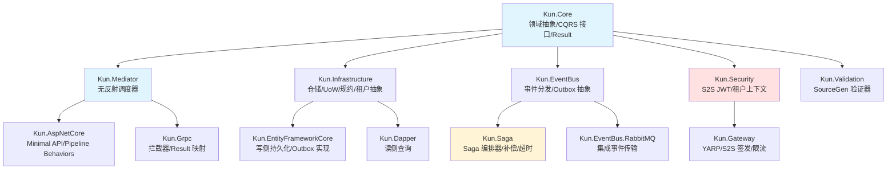

# 模块地图

## 依赖关系图



## 分层规则

```
┌─────────────────────────────────────────────────────────┐
│  Host Layer                                             │
│  Kun.AspNetCore / Kun.Grpc / Kun.Gateway                │
├─────────────────────────────────────────────────────────┤
│  Infrastructure Layer                                   │
│  Kun.EntityFrameworkCore / Kun.Dapper                   │
│  Kun.EventBus.RabbitMQ / Kun.Saga                       │
├─────────────────────────────────────────────────────────┤
│  Abstraction Layer                                      │
│  Kun.Mediator / Kun.Infrastructure                      │
│  Kun.EventBus / Kun.Security / Kun.Validation           │
├─────────────────────────────────────────────────────────┤
│  Core Layer                                             │
│  Kun.Core (zero dependencies)                           │
└─────────────────────────────────────────────────────────┘
```

## 典型请求调用路径（HTTP → DB → 事件）

```
HTTP Request
    │
    ▼
Kun.Gateway                      [签发 S2S JWT]
    │
    ▼
Kun.AspNetCore / Minimal API     [校验 S2S JWT / 注入 ITenantContext]
    │
    ▼
Kun.Mediator.Send(Command)       [Pipeline: Logging → Validation → Auth → Handler]
    │
    ▼
Command Handler                  [纯 C#，依赖 IRepository<T>]
    │
    ▼
Kun.EntityFrameworkCore          [聚合根 + Outbox 同事务落库]
    │
    ▼
PostgreSQL                       [SaveChanges = 原子事务]
    │
    ▼
Kun.EventBus OutboxPublisher     [扫描 pending 消息 → RabbitMQ]
    │
    ▼
Kun.EventBus.RabbitMQ            [传递 W3C Trace Context]
    │
    ▼
下游服务消费端                    [IdempotentConsumerDecorator → Handler]
```

## 典型查询路径（HTTP → DB 只读）

```
HTTP Request
    │
    ▼
Kun.AspNetCore / Minimal API
    │
    ▼
Kun.Mediator.Send(Query)
    │
    ▼
Query Handler
    │
    ▼
Kun.Dapper (读侧连接)            [AOT 源生成的映射代码]
    │
    ▼
PostgreSQL (只读副本 / 读库)
```

## Saga 路径（跨服务长事务）

```
Command Handler
    │
    ▼ StartSagaAsync(ctx)
    │
Kun.Saga Orchestrator            [持久化 SagaInstance + 首步入队]
    │                               (与业务同事务)
    ▼
Outbox (step message)
    │
    ▼
SagaStepExecutor (BackgroundService)
    │
    ▼  step.ExecuteAsync()
    │
远程服务 / 本地 Handler
    │
    ▼  成功 → 下一步                  失败 → CompensateAsync (反向)
```
